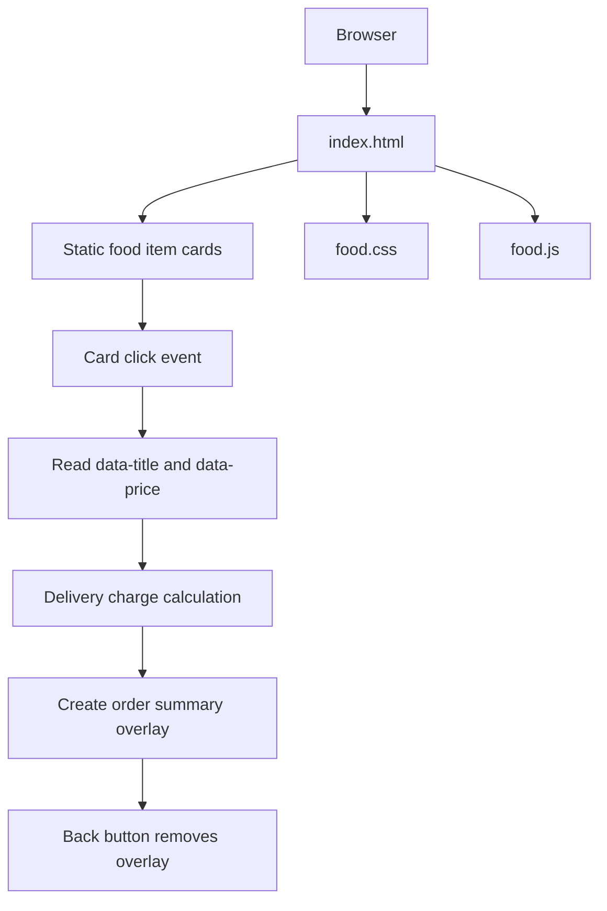

# Architecture

## Data flow
Food item names and prices are stored in HTML data attributes. The script reads those values when a card is clicked, computes the displayed total, and constructs popup elements in the DOM. There is no server-side order service.
